# Scaniverseで3DGSにチャレンジしよう！

この課題にかかる時間は概ね30分以内です。
聞き慣れない単語や概念、モチベーションはあると思いますが、サクッと終わらせましょう。

アカウント登録は2026年11月現在必須ではありません。(旧システム)
なお新システムを利用し、アカウント登録をするとVisual Positioning Systemという高精度に立体をAR表示できる仕組みなどを利用することもできます。

### iPhone編

iPhone 12 Pro以降の上位機種(あるいはiPad Pro)にはカメラの他に赤外線距離(ToF)センサー LiDARが存在していて、
この機種だと「メッシュ」スキャンを行うと高精細な立体を保存しやすいです(食べ物などをスキャンすると違いが顕著だと思います。)

iPhone 12 Pro以降のLiDARセンサーも利用できるので、メッシュ、という項目があると思います。

Splat(この課題で使う方式)の流れです。画面は画面収録から切り出したものです。

| 手順 | 画面 | 操作 |
|---|---|---|
| 1 | 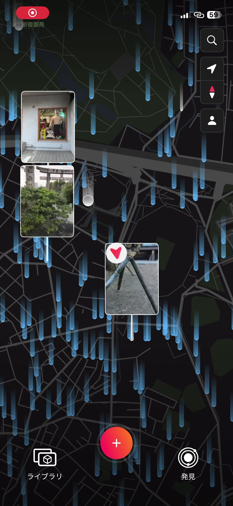 | ホーム画面の下部中央にある「＋」をタップします。 |
| 2 | 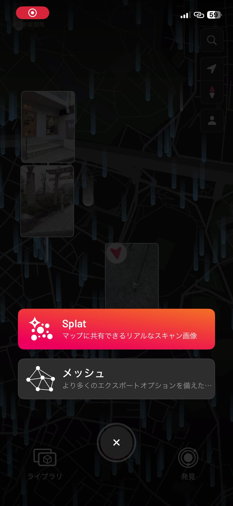 | 「Splat」を選びます。「メッシュ」は従来方式で、エクスポート形式の選択肢が多いのが特徴です。 |
| 3 | 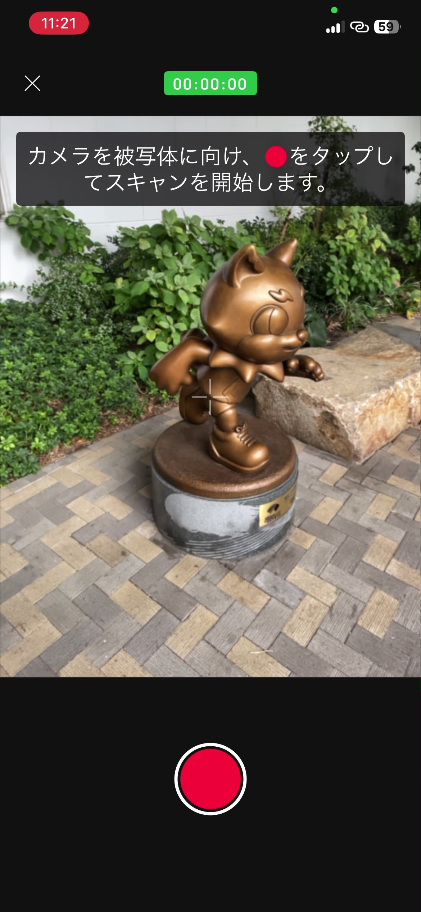 | 被写体にカメラを向け、赤い録画ボタンをタップするとスキャンが始まります。 |
| 4 | 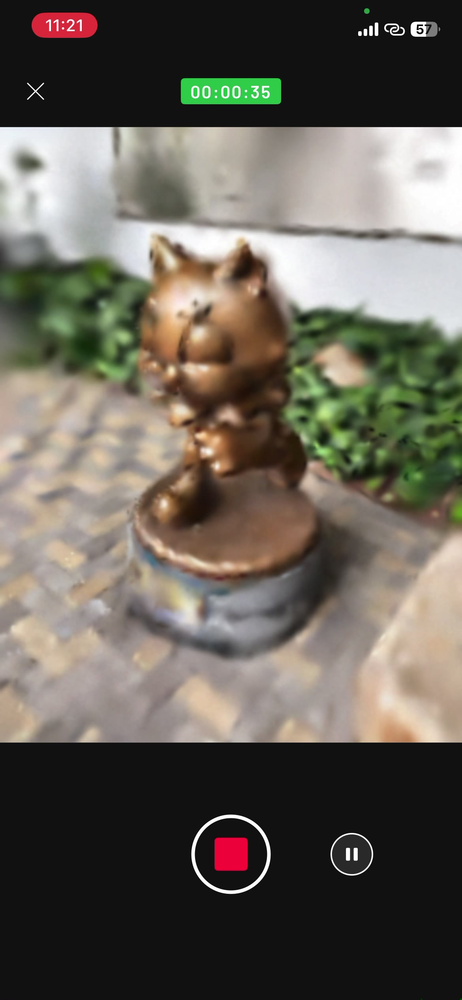 | 被写体の周りを移動しながら、ハイアングルとローアングルを含めて四方から撮影します(画面内の案内より)。終了するときは中央の■をタップします。 |
| 5 | 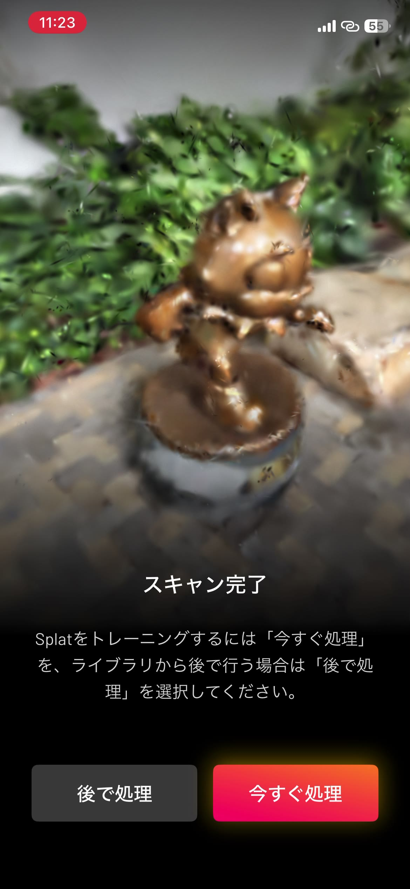 | 「今すぐ処理」でSplatの生成を始めます。「後で処理」を選んだ場合は、ライブラリから後で処理できます。 |
| 6 | 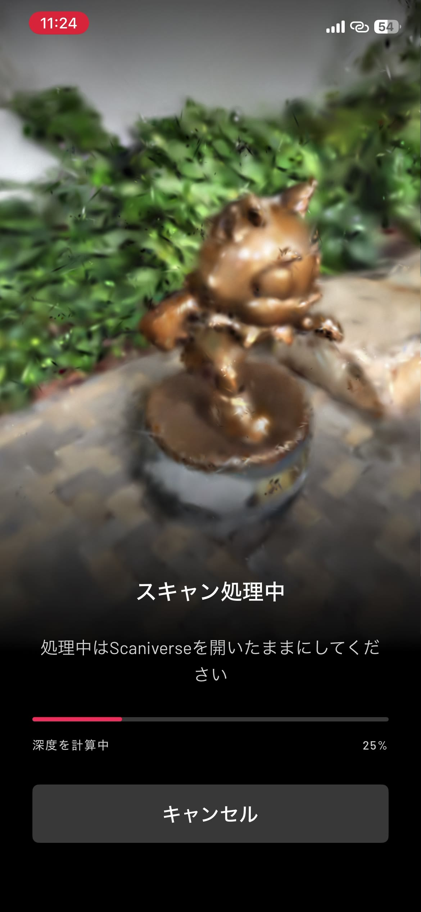 | 処理中はScaniverseを開いたままにします。進捗バーの下に「フレームの位置合わせ」「深度を計算中」などの段階名が表示されます。この録画では約3分40秒で完了しました。 |
| 7 | 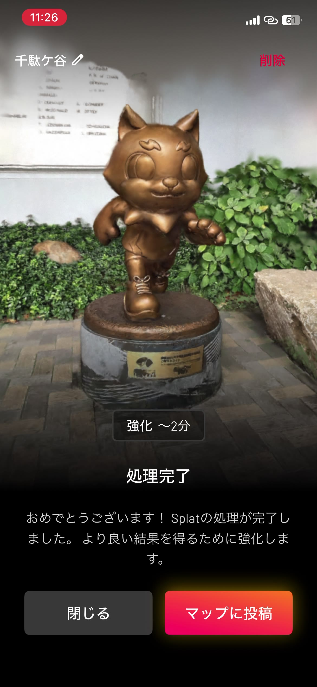 | 処理完了の画面です。「強化」で追加の学習を行い、結果を改善できます(画面の表示では約2分)。 |

メッシュで撮影した場合は、撮影後に処理モードを選びます。

| 手順 | 画面 | 操作 |
|---|---|---|
| 1 | 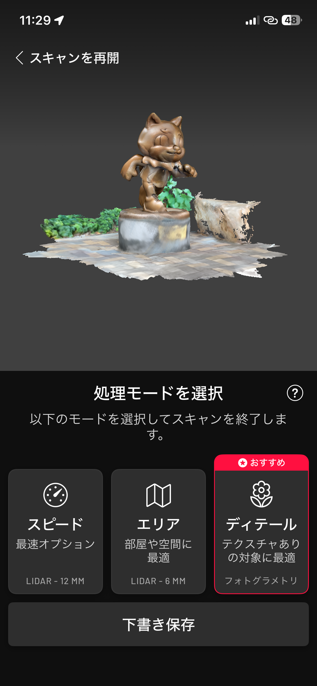 | 処理モードを選びます。「スピード」「エリア」はLiDAR(12mm / 6mm)を使うモード、「ディテール」はフォトグラメトリで、テクスチャのある対象向けとして「おすすめ」と表示されています。 |
| 2 | 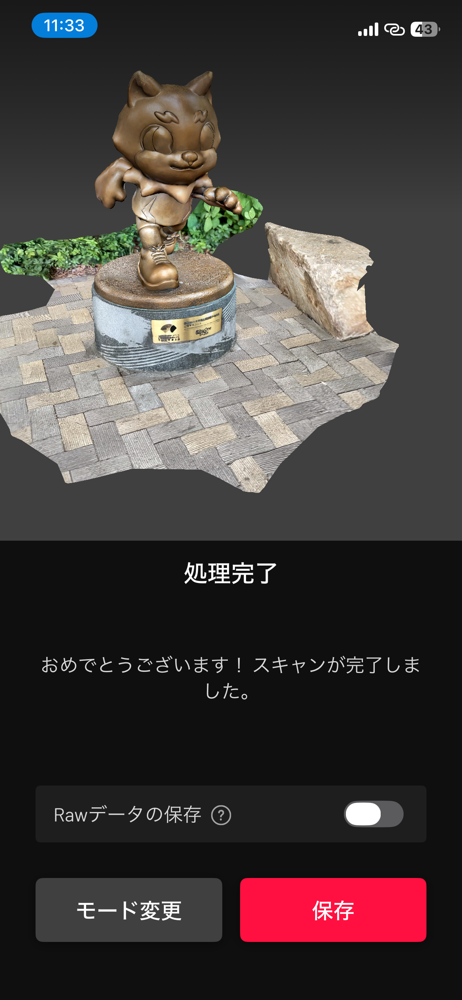 | 処理完了の画面です。「保存」で保存します。「Rawデータの保存」のスイッチと「モード変更」のボタンもあります。 |

### Android編

Android版はSplatとメッシュを選ぶ画面から始まります。画面表示は英語です。

| 手順 | 画面 | 操作 |
|---|---|---|
| 1 | 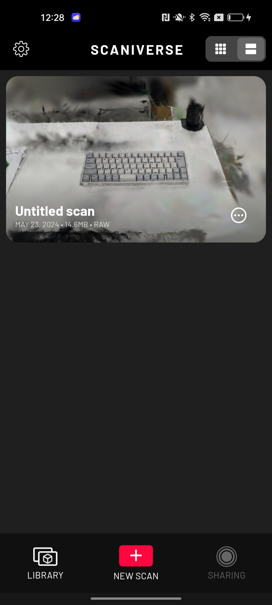 | ライブラリ画面です。下部中央の赤い「NEW SCAN」(＋)をタップします。 |
| 2 | 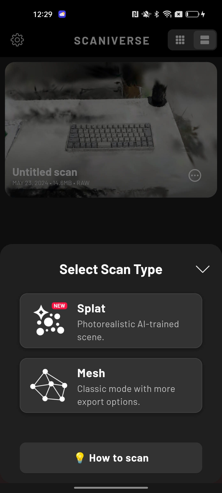 | 「Splat」(Photorealistic AI-trained scene)を選びます。「Mesh」は従来のモードで、エクスポートの選択肢が多い方式です。 |
| 3 | 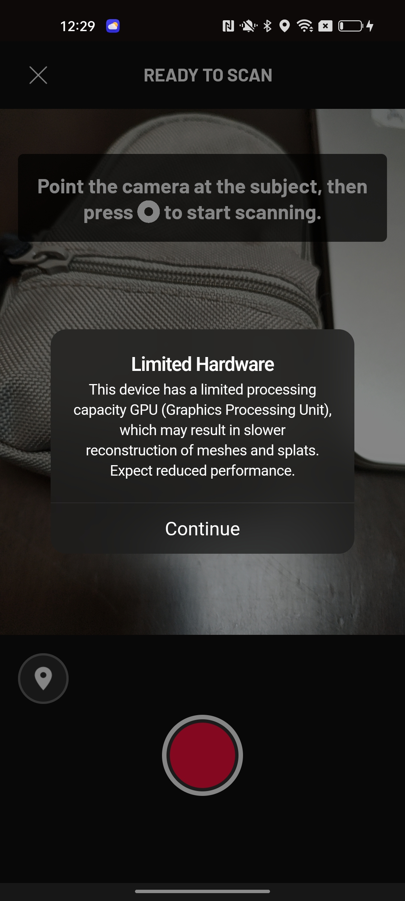 | 端末のGPU性能が限られている場合、処理が遅くなる可能性があるという警告が表示されることがあります。「Continue」で続行できます。 |
| 4 | 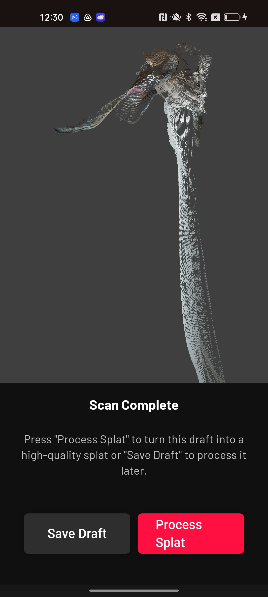 | 撮影後の画面です。「Process Splat」で高品質なSplatへの処理を始めます。「Save Draft」を選ぶと、処理を後で行えます。 |
| 5 | 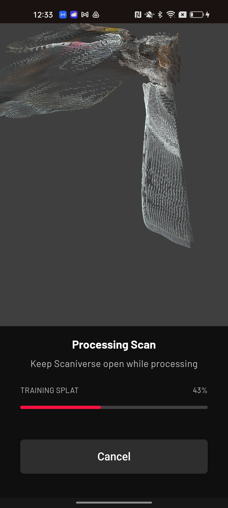 | 処理中の画面です。「Keep Scaniverse open while processing」と表示されるので、アプリを開いたままにします。この例では20分前後かかりました(画面左上の時刻は、進捗43%で12:33、完了画面で12:51)。 |
| 6 | 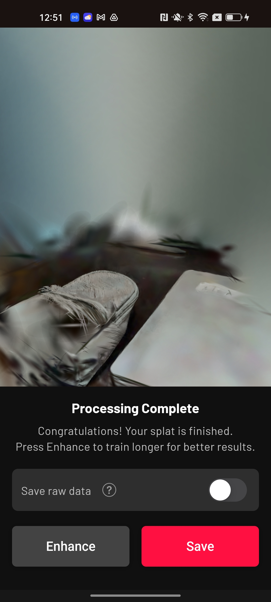 | 処理完了の画面です。「Enhance」でさらに学習させて結果を改善できます。「Save」で保存します。「Save raw data」のスイッチもあります。 |
| 7 | 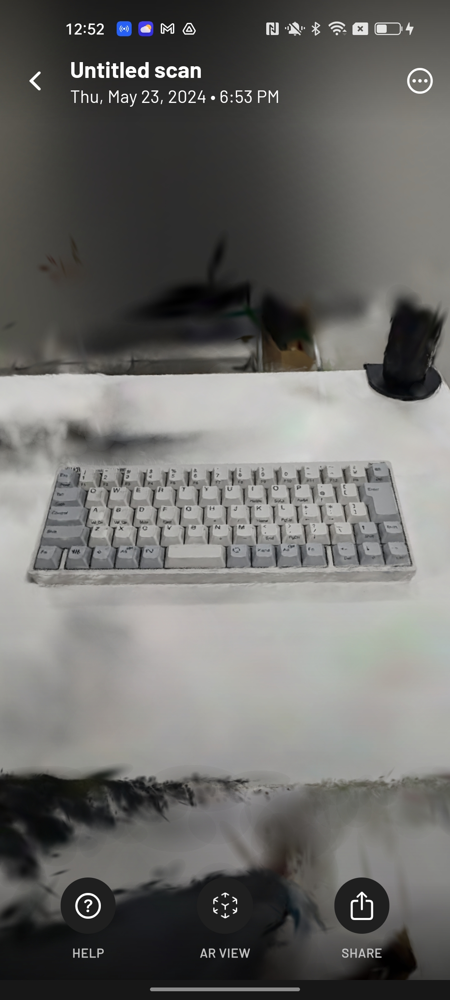 | 保存したSplatの表示画面です。画面下部に「HELP」「AR VIEW」「SHARE」のボタンがあります。 |

### その他

iPhoneのLiDARセンサーの取得限界が5mほどであるのに対して、3DGSでの光学的なデータ取得範囲はもう少し広いです(~30mくらいがぼんやりデータとして残ります。)
ただし、「しっかり」取れている部分のデータに関してはデータ取得中の対象の明瞭さが変化するのでこれを参考にぐるりと回ると良いと思います。

回り込めない地物もある程度綺麗に撮れます。

Scaniverseはエクスプローラー(閲覧)機能を持っているので、地図から地物を探すことや、反対に、公開したい思い出を地図上に投稿することができます。
2024年 XR KaigiにおいてNianticに確認したところ、Scaniverseで撮影したメッシュスキャンデータ、およびSplatデータは撮影者に著作権が発生し、公開する上でのライセンスは撮影者によって設定できるそうです。
対象となる地物の肖像権などは別途存在する場合もありますが、改変可能な状態で自由に使ってもらいたい場合、

- 撮影者のアカウントなどのライセンス表示をしてもらいたければCC BY
- 撮影者のアカウント表示も必要ない場合は CC0

という感じで扱うと良いと思います。

## Gaussian Splattingについての補足

講義では触れきれない部分がありこちらに残しておきます。

Gaussian Splatting 自体は 2023年ごろから広まり始めた比較的新しい技術分野です。

連続写真から立体(メッシュ)を作ろう、というモチベーションではフォトグラメトリが、

連続写真から立体(メッシュ)を作ろう、点群を作成しようNeRFが

考案されていましたが、

風景を再現しよう、というモチベーションに立ってGaussian Splattingは考え出されました。

当初は計算リソースが膨大に必要で、スペックの高いコンピュータマシンでしか採用できない手法でしたが、
半年ほどでスマートフォンの中でも動くように最適化され、私たちのスマートフォンでもScaniverseをはじめ、さまざまなアプリで作成が可能になっています。

メッシュスキャンと比べた時のメリットは、特に風景やメッシュスキャンで取りこぼしがちな細い形状のもの、光を吸収、あるいは反射してしまう対象を記録に残しやすいということに尽きます。(弱点としては表面の凹凸のような形状や、碑板文面などを高精細に残すのがやや苦手です)

2025年から2026年は3DGSを利用したサービス開発や表現手法がAIのアシストも相まってとても進みました。

手法の活用としては建築や土木といった分野で、現場の情報量を多く検討フェーズに持ち帰られるようになったことは仕事のあり方を大きく変えたと言えます。

メディアの表現としても活用が模索され始めていてMVも作成されているので興味がある方は見てみてください。

丘にいる
<https://www.youtube.com/watch?v=rIIcPqROMxo>

関連して、メッシュスキャンを用いて現実の都市をつなぎ合わせてプレイアブルにしたゲーム作品も存在しています。

キム・アヨン デリバリーダンサーシリーズ
<https://artnewsjapan.com/article/26713>

通常 Gaussian Splatting はメッシュ(当たり判定)の作成は苦手としていましたが、
Arrival Spaceでは、3DGS形式で作成した風景の中を歩くことができるようにしてくれています。

入力データが高精細であれば特に広域のデータは作成しやすくなります。
ミラーレスカメラなどをお持ちの方は撮影データを繋ぎ合わせると立体データを作成できるような時代が来ていることを知っておくと、旅行先での思い出の持ち帰り方が一つ増えるかもしれません。

専用機器(に近いコンセプトの商品)の発売も相次いでいて、
現場レベルだとXGRIDS社の商品は持ち歩くだけで空間全体をスキャンしたり、街道を丸ごと立体にするような仕組みを持っています。 (ソフトウェア側で通行人と認識された立体を削除する機能もあります。)
最近ではInsta360シリーズのX4~X6が3DGSに対応したので、たとえば海水浴やウインタースポーツのようなレジャーなどを丸ごと残すことも容易いでしょう。

卑近な例だと、学生のみなさんであればレポートとしてフィールドワークを行うことが少なくないと思いますが、調査の強い味方となる手法の一つだと思います。
ぜひ活用してみてください。
