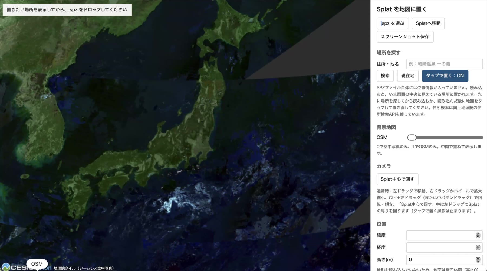
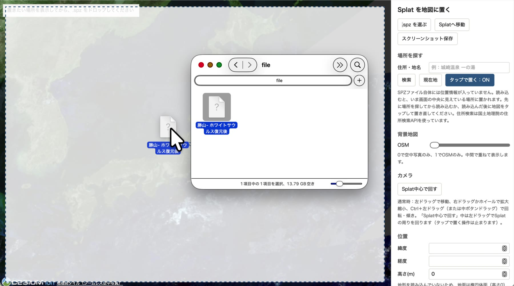
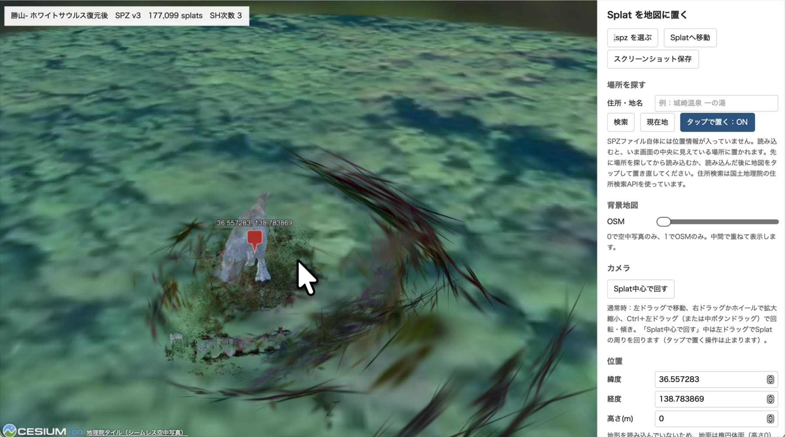
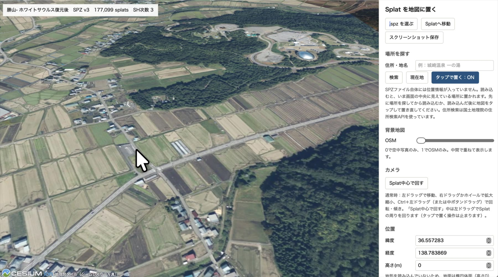
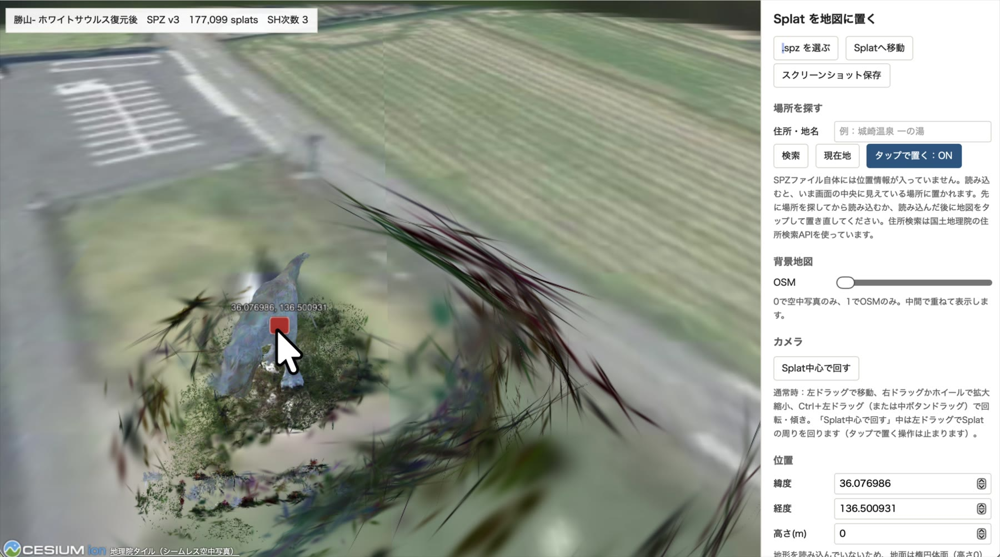
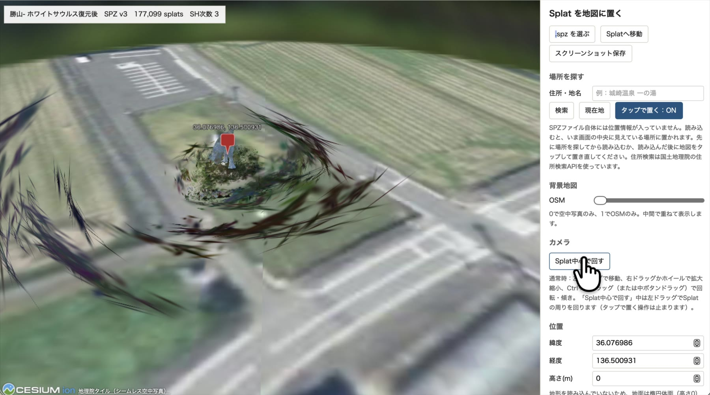
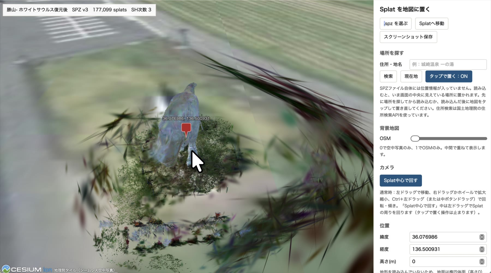
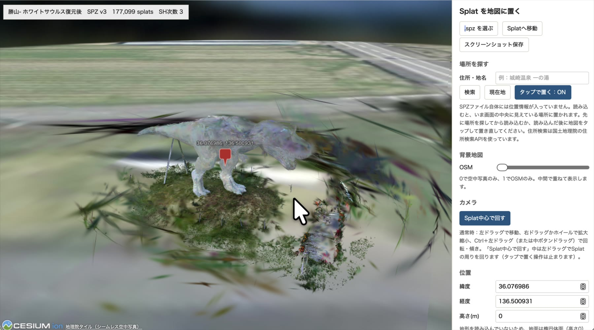

# 課題2：Splatを地図に置いてスクリーンショットにしよう

spzファイルを地図上に読み込み、適切な位置に移動させてスクリーンショットにする手順です。
画面は画面収録から切り出したものです。画像をクリックすると大きく表示されます。

| 手順 | 画面 | 操作 |
|---|---|---|
| 1 |  | 「Splat を地図に置く」の画面です。左が地図、右が操作パネルです。パネルには「.spz を選ぶ」「Splatへ移動」「スクリーンショット保存」のボタンがあります。 |
| 2 |  | spzファイルを地図の上にドラッグ＆ドロップします。ドロップできる状態になると、地図が白っぽくなり点線の枠が表示されます。「.spz を選ぶ」ボタンからファイルを選ぶこともできます。 |
| 3 |  | 読み込みが終わると、画面左上にファイルの情報が表示されます(この例では「SPZ v3 / 177,099 splats / SH次数 3」)。SPZファイル自体には位置情報が入っていないため、Splatはいま画面の中央に見えている場所に置かれます。 |
| 4 |  | 置きたい場所が見えるところまで、地図を動かします。左ドラッグで移動、右ドラッグまたはホイールで拡大縮小できます。住所・地名で探すこともできます(下の操作メモ)。 |
| 5 |  | 「タップで置く：ON」の状態で、置きたい場所をクリック(タップ)します。Splatがその場所に移動し、パネルの「位置」の緯度・経度が更新されます。 |
| 6 |  | Splatの周りを回って見たいときは、パネルの「カメラ」にある「Splat中心で回す」をクリックします。 |
| 7 |  | ボタンが青く表示されている間は、左ドラッグでSplatの周りを回れます。この間は、地図をタップして置く操作は止まります(パネルの説明より)。 |
| 8 |  | 見せたい角度と大きさに調整します。調整できたら、パネルの「スクリーンショット保存」で画像として保存します。 |

## 操作メモ

パネルに書かれている説明のうち、位置決めで使うものをまとめます。

- 場所を探す：「住所・地名」に入力して「検索」を押すと、その場所へ移動します。住所検索には国土地理院の住所検索APIが使われています。「現在地」ボタンもあります。
- 背景地図：スライダーで、空中写真とOSMの重ね具合を変えられます。0で空中写真のみ、1でOSMのみ、中間で重ねて表示されます。
- カメラ(通常時)：左ドラッグで移動、右ドラッグまたはホイールで拡大縮小、Ctrl＋左ドラッグ(または中ボタンドラッグ)で回転・傾きを変えられます。
